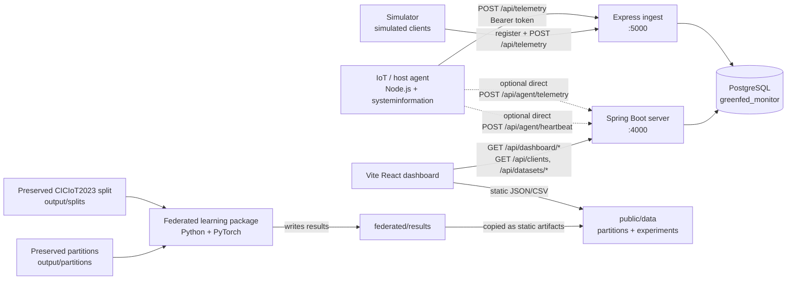

# System Architecture

This document describes the implemented GreenFed-IDS components, their data flow, ports, storage, and known operational limits. It reflects the repository state, not an intended future design.

## 1. Logical view

The main runtime components are:

| Component | Runtime | Port | Status |
|---|---|---:|---|
| Spring Boot `server/` | Java 21, Spring Boot 4.1.1 | 4000 | Primary backend used by the dashboard |
| Express `api/` | Node.js, Express 5 | 5000 | Legacy telemetry ingest; dependencies are not installed in the current workspace |
| Agent `agent/` | Node.js, systeminformation | outbound | Collects host CPU, memory, disk, network and posts to the Express ingest |
| Simulator `simulator/` | Node.js | outbound | Registers simulated clients and posts generated telemetry to the Express ingest |
| Dashboard `client/greenfed-dashboard-download/` | Vite + React | 5173 dev | Built static bundle also available in `dist/` |

The Vite development proxy targets `http://127.0.0.1:4000`, so the dashboard's API calls resolve to the Spring Boot service even though the request is same-origin in the browser.

## 2. Component responsibilities

### 2.1 Agent

`agent/src/index.js` loops at `COLLECTION_INTERVAL_MS` (default 10,000 ms). It calls four collectors:

- `cpuCollector.js`: CPU utilization.
- `memoryCollector.js`: total, used, available memory.
- `diskCollector.js`: per-filesystem usage.
- `networkCollector.js`: per-interface transfer and bandwidth measurements.

It posts a payload with `resource`, `network`, and `disk` sections to the configured API (`/api/telemetry`, typically the Express ingest). A heartbeat endpoint updates `last_seen_at`. The agent is a host monitor; it does not train models and does not read the CICIoT2023 split.

### 2.2 Simulator

`simulator/src/index.js` registers `SIMULATOR_CLIENT_COUNT` (default 5) simulated clients on startup, then generates resource, disk, and network telemetry every `COLLECTION_INTERVAL_MS` (default 10,000 ms). It posts to the Express ingest with each client's bearer token. The simulator does not persist credentials: restarting it registers new clients, which is why duplicate registrations appear in the database. This is a known limitation, not an intentional feature.

### 2.3 Spring Boot backend

The backend is organized by feature:

- `client/`: client registration, credential issuance, heartbeat, client listing.
- `telemetry/`: validated telemetry ingest and persistence.
- `dashboard/`: read-only aggregate queries for the overview and client table.
- `dataset/`: serves the dataset summary report packaged as a classpath resource.

Registration issues a random 32-byte token, returns it once, and stores only its SHA-256 hash in `client_credentials`. Telemetry and heartbeat requests authenticate with that token. The token is a bearer credential, not a full identity or authorization system.

The dashboard reads only aggregated telemetry and never exposes raw CICIoT2023 records. Aggregates use `DISTINCT ON (client_id)` with `ORDER BY observed_at DESC` so each client contributes its latest sample rather than every historical sample.

### 2.4 PostgreSQL

Flyway migrations create and evolve the schema:

- `V1__initial_schema.sql`: base tables.
- `V2__create_monitoring_tables.sql`: `clients`, `client_credentials`, `experiments`, `experiment_clients`, `host_samples`, and resource sample tables.
- `V3__add_client_last_seen.sql`: `last_seen_at`.
- `V4__create_disk_samples.sql`: disk samples.

Hibernate runs with `ddl-auto=validate`; schema changes must go through migrations. The database name is `greenfed_monitor` on `localhost:5432`; the password is read from `DB_PASSWORD`.

### 2.5 Dashboard

The React dashboard has four data sources:

1. **Live APIs** (`/api/dashboard/overview`, `/api/dashboard/clients`) for client counts and latest resource state.
2. **Static partition reports** under `public/data/partitions/{iid,non_iid}/partition_report.json`, copied from the preserved partition output.
3. **Static experiment aggregates** under `public/data/experiments/aggregate_full.json`, plus per-run summaries and metadata under `runs/`.
4. **Dataset summary** (`/api/datasets/summary`) served from the packaged `dataset_report.json`.

If a live API is unavailable, the dashboard shows an offline/empty state rather than inventing values. Experiment data is static by design; the dashboard does not start or control training runs.

### 2.6 Federated learning package

`federated/greenfed_fl/` is a standalone Python package:

- `paths.py`: repository paths and environment overrides.
- `partitioning.py`: IID and Dirichlet partitioning, validation, and reports.
- `data.py`: CSV loading, feature/label separation, client construction, validation split, scaling, class weights.
- `model.py`: MLP `39 -> 128 -> 64 -> 34`.
- `fedavg.py`: local training, sample-weighted aggregation, evaluation, communication and CPU accounting.
- `context.py`: client context fields, provenance values, and simulated profiles.
- `selection.py`: `all`, `random`, `resource`, and `context` strategies with eligibility checks and scoring.
- `metrics.py`: accuracy, balanced accuracy, macro-F1, weighted F1.

CLIs at `federated/`:

- `validate_partitions.py`
- `generate_context.py`
- `run_experiment.py`
- `repartition.py`
- `aggregate_results.py`

Results are written under `federated/results/<run_id>/` and aggregated into `aggregate_full.{json,csv,md}`. The dashboard copies these artifacts into its static data directory; there is no live training control API.

## 3. Data flow

### 3.1 Monitoring flow

1. Agent collects a sample.
2. Agent posts telemetry with its bearer token.
3. Backend validates ranges and consistency, resolves the client, and persists resource, disk, and network rows.
4. Dashboard requests aggregates; backend returns latest-per-client values.
5. Agent heartbeat updates `last_seen_at`; active clients are those seen in the last five minutes.

### 3.2 Federated experiment flow

1. Preserved CSVs are read from `output/splits/train.csv` and `test.csv`.
2. Partition files are read from `output/partitions/{iid,non_iid}`; validation checks counts, duplicates, and coverage.
3. Simulated client contexts are read from `federated/context/{iid,non_iid}_context_seed42.json`.
4. Each round selects clients, trains locally, aggregates state dictionaries weighted by sample count, and logs metrics.
5. After the configured rounds, the global model is evaluated on the held-out test set once.
6. Results and metadata are written per run; `aggregate_results.py` groups runs by scenario and strategy and computes mean and sample standard deviation across seeds.
7. Aggregates are copied to the dashboard's static data folder and rendered.

### 3.3 Dataset presentation flow

The dataset summary is a packaged JSON resource. The dashboard renders class counts, client class matrices, and rare-class shares from static partition reports. The training and test CSVs are not served to the browser.

## 4. Deployment and configuration

### 4.1 Prerequisites

- Java 21 and Maven wrapper.
- PostgreSQL 18.x with database `greenfed_monitor`.
- Python 3.13 with PyTorch, NumPy, pandas, scikit-learn, pytest.
- Node.js 22 for the dashboard and agent.

### 4.2 Configuration

Backend `server/src/main/resources/application.properties`:

- `server.port=4000`
- `spring.datasource.url=jdbc:postgresql://localhost:5432/greenfed_monitor`
- `spring.datasource.password=${DB_PASSWORD}`
- `spring.jpa.hibernate.ddl-auto=validate`
- Flyway enabled.

Python environment overrides:

- `GREENFED_TRAIN_CSV`
- `GREENFED_TEST_CSV`
- `GREENFED_PARTITIONS_DIR`
- `GREENFED_RESULTS_DIR`
- `GREENFED_CONTEXT_DIR`

### 4.3 Startup order

1. Start PostgreSQL.
2. Start the Spring Boot server (Flyway migrates on startup).
3. Start the dashboard dev server or serve the built bundle.
4. Optionally start the agent with a registered client token.

## 5. Trust, security, and privacy boundaries

- Raw dataset rows stay in the Python training environment and are never posted to the backend.
- Telemetry is client-authenticated with a hashed bearer token.
- The dashboard has no authentication; it is a local engineering dashboard, not a production multi-tenant service.
- There is no secure aggregation, differential privacy, or poisoning defense. A client's local update is visible to the server.
- CORS is open in the Express service and handled by the Vite proxy in development. Production deployment would need a restrictive CORS policy.
- Secrets are read from environment variables; `.env` files must not be committed.

## 6. Operational limits

- Simulated federated clients run on one host. They are independent data partitions, not independent hardware or network paths.
- The context file is simulated; provenance values distinguish measured, simulated, estimated, and unavailable data.
- Experiment management endpoints (`POST /api/experiments`, start/stop, live telemetry read) are not implemented. Only dashboard read APIs exist.
- The Express API is a parallel legacy ingest path; running both services against the same database can produce duplicate or inconsistent client records.
- Simulator client reuse is not implemented; restarting a simulator can register duplicate clients.
- No energy meter is integrated. CPU seconds and communication megabytes are proxies, not a life-cycle carbon assessment.

## 7. Why this architecture

The design separates concerns that have different failure modes:

- Monitoring is live, small-payload, and transactional.
- Federated training is batch, compute-heavy, and reproducible.
- Dashboard presentation mixes live aggregates with immutable experiment artifacts.

Keeping experiment artifacts static makes the reported numbers auditable and prevents the UI from presenting training as a live service it cannot control. It also makes it clear which values are measured telemetry and which are offline results.
